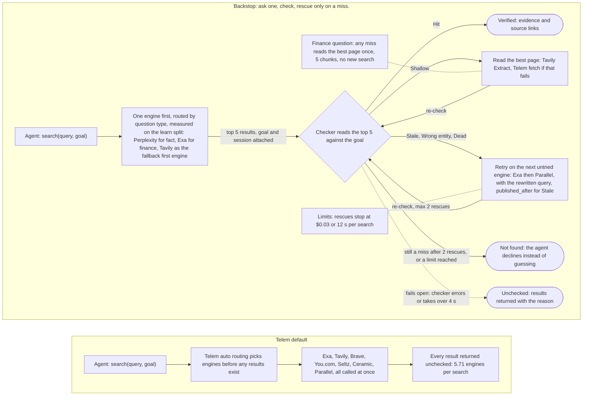

# Backstop

**Verified search for AI agents, built on Telem.**

Backstop sits between your agent and Telem's search API. It asks one engine, chosen by
question type, checks whether the results actually answer what the agent needs, rescues
misses on the engine our data says catches them, and returns `NOT_FOUND` instead of letting the agent guess.
It is for teams running research and diligence agents, where a confident wrong fact
in a memo, a model or a customer answer costs real money. Backstop is open source,
installable, and production-ready: bounded in cost and time, fail-open, typed, and
fully traced.

## Quickstart

```sh
pip install -e .            # Python 3.11+; put TELEM_API_KEY and ANTHROPIC_API_KEY in .env
```

```python
from backstop import BackstopTelem

client = BackstopTelem()    # was: client = AsyncTelem()
resp = await client.search("What was Stripe's valuation in its 2023 round?", goal="find the valuation figure")
print(resp.status, resp.results[0].url, resp.results[0].rank_reason)   # HIT, the evidence URL, "evidence"
```

That one-line swap is the whole integration. The response keeps Telem's shape
(`results`, `by_provider`, `session_id`), so existing call sites work unchanged, and
adds `status`, `verdict`, `why`, `note`, `trace`, `engine_calls`, `cost_usd`,
`latency_ms` and a `rank_reason` on every result. Every other `AsyncTelem` method is
passed through.

## How it works on Telem

Default routing asks several engines per search, chosen before any results exist, and
nothing checks whether the answer came back. Backstop puts the decision after the
results instead.



Each rescue takes the next untried engine in `out/rescue_table.json` after the engine
that just missed, so after a Tavily or Perplexity miss the order is Exa, then Parallel.
Page reads and engine retries share the limit of 2 rescues; an engine error moves to the
next engine without using one. Engines per search: 1,600 engine calls over 280 searches
for Telem default and 261 over 242 for Backstop in the held-out eval (`out/results.json`).

**Query understanding.** The checker reads the query, the agent's goal, today's date
and the top 5 results, and says why a search missed: wrong entity, stale, shallow, or
nothing relevant. Each miss comes with a rewritten query aimed at that failure, and
the rewrite is recorded in the trace as a before and after. An illustrative example:

| | Query |
|---|---|
| Before (agent) | `Mercury funding round valuation` |
| Miss | `WRONG_ENTITY`: results cover Mercury Insurance, not the fintech |
| After (rewrite) | `Mercury fintech banking startup Series C valuation` |

**Retrieval.** Every search goes through one Telem API with pinned engines
(`providers_include`), the agent's `goal`, one Telem `session` per run so all calls are
grouped in Telem's console, `published_after` for stale retries, and Telem fetch as the
page-read fallback. The first engine depends on the question type: a regex over the
query and goal marks a search as finance or fact, and `out/first_engine.json`, built on
the learn split only, maps each type to the engine whose first call surfaced the answer
for the most questions of that type (currently Perplexity for fact, Exa for finance).
With routing off, or without that table, every search starts on `FIRST_ENGINE` (Tavily).
The rescue order (which engine to try after a given engine misses) comes from a hit
matrix: every question asked on six engines through the same API, in one result format.
That matrix is the part that is hard to build without Telem. Tavily stays in the rescue
order, and every `SHALLOW` page read goes through Tavily Extract.

**Session ledger.** Each Telem search also carries `context` and `metadata` naming the
Backstop step (`initial`, `rescue_1`, `rescue_2`, `engine_retry`, `extract_recheck`),
the verdict that triggered it, the engine and `backstop_version`. Telem's session
console then shows the verification trajectory itself, not just a list of queries, and
the session id is recorded on every answer (`telem_session_id`). The labels stay out of
cache keys, and if Telem ever rejects them the call is retried once without them.

**Ranking.** Results from every engine called are merged and deduplicated by URL,
then ranked: the result the checker cited as evidence first, then results that more
than one engine returned (more engines first), then the best original engine rank.
Each result says why it is where it is: `evidence`, `agreement: 2 engines`, `engine rank 3`.

**Grounded results.** A `HIT` points at the exact result holding the answer, so the
agent can cite its URL. A miss that survives two rescues becomes `NOT_FOUND`, with a
note telling the agent to answer NOT FOUND unless it has other evidence. The checker's
cost is always counted in `cost_usd`.

### Miss autopsy

Backstop catches a bad search at call time. The autopsy does the same after the fact,
for any Telem session, including ones Backstop never touched:

```sh
curl -s http://localhost:8000/v1/autopsy/<telem_session_id> -H "Authorization: Bearer bk_live_one"
```

It reads the session back with Telem's Sessions API (`sessions.history(id, full=True)`
and `sessions.results(id)`), rebuilds the ordered searches (query, goal, engines,
results), and runs the checker on each against the recorded goal (or the first query).
The answer names the first search that missed (`first_failure_index`), where Backstop
would have stopped (`stop_index`, the first `HIT`), the rescue it would have tried next
(`next_rescue`, from the learned rescue table), and how many searches the agent spent
after the first miss. It checks at most 25 searches and returns within 30 seconds,
marking any step it did not reach. Telem's session payloads carry no judge or quality
score today, so `telem_judge` is `null` and the note says so; if one appears, each step
shows it along with the checker's agreement (Cohen's kappa). In Python:
`await so.autopsy.autopsy(session_id)`.

### Verdicts and rescue actions

| Verdict | Meaning | Action |
|---|---|---|
| `HIT` | A top-5 title or snippet states the answer | Return results, tell the agent to stop |
| `SHALLOW` | The right page is there, but the snippet lacks the answer | Read the page with Tavily Extract (Telem fetch as fallback) and check again |
| `STALE` | On topic, but older than the goal needs | Retry on the next engine with `published_after` and the rewrite |
| `WRONG_ENTITY` | About a similarly named entity | Retry on the next engine with the rewrite |
| `DEAD` | Nothing relevant | Retry once on the next engine with the rewrite |

At most two rescues per search, and an engine is never asked twice in one search.

### Outcomes

| Status | Meaning |
|---|---|
| `HIT` | The answer is in the results. `note` says which result. |
| `NOT_FOUND` | No engine surfaced it within the limits. The agent should not guess. |
| `UNCHECKED` | The checker failed or timed out. The results are returned unverified, with the reason. |

## Configuration

Set in `.env` or the environment; the limits can also be set on the client or per call.

| Setting | Default | Meaning |
|---|---|---|
| `TELEM_API_KEY` | | Telem key |
| `TELEM_BASE_URL` | `https://router.telem.ai` | Telem router |
| `ANTHROPIC_API_KEY` | | Key for the checker model |
| `CHECKER_MODEL` | `claude-haiku-5-5` | Model that labels each search |
| `CHECKER_BACKEND` | `cascade` | `llm`, `decision` or `cascade`. `cascade` asks the Decisions checker (`gpt-6-luna`, using `OPENAI_API_KEY`) first and re-checks uncertain `HIT`s with `CHECKER_MODEL`. If the key is missing or Decisions fails, it falls back to the configured LLM checker and logs a warning once per process. This is the configuration measured in [Results](#results) |
| `CHECKER_CASCADE_THRESHOLD` | 0.7 | A Decisions `HIT` below this confidence goes to the LLM checker |
| `FIRST_ENGINE_ROUTING` | `on` | Pick each search's first engine by question type from `out/first_engine.json`, built on the learn split only (`python -m so.router build`); currently Perplexity for fact questions and Exa for finance |
| `FIRST_ENGINE_FINANCE_PATTERN` | accounting, market and filing terms | Regex over query and goal that marks a search as finance; every other search is fact |
| `FIRST_ENGINE` | `tavily` | First engine when routing is `off` or the routing table is missing |
| `FALLBACK_ORDER` | `exa,perplexity,brave,parallel,ceramic` | Rescue order when `out/rescue_table.json` is absent |
| `MAX_RESCUES` / `max_rescues` | 2 | Rescues per search |
| `SEARCH_MAX_COST_USD` / `max_cost_usd` | 0.03 | Spend cap per search, checker included |
| `SEARCH_TIMEOUT_S` / `timeout_s` | 12 | Wall-clock budget per search |
| `CHECKER_TIMEOUT_S` / `checker_timeout_s` | 4 | Slower checks fail open as `UNCHECKED` |
| `TELEM_BUDGET_USD`, `LLM_BUDGET_USD` | 25 | Process-wide spend guards |

```python
client = BackstopTelem(max_cost_usd=0.02)                     # client default
resp = await client.search("...", goal="...", timeout_s=20)   # per call
```

Engine errors are recorded and skipped without spending a rescue. Telem failing
entirely raises `backstop.TelemUnavailable`. See [docs/api.md](docs/api.md) for the
full reference.

## Hosted API

The same verified search is available over HTTP, with bearer keys, per-key usage
metering in SQLite and a per-key rate limit of 60 requests per minute.

```sh
echo "BACKSTOP_API_KEYS=bk_live_one" >> .env
uvicorn server.app:app --port 8000

curl -s http://localhost:8000/v1/search \
  -H "Authorization: Bearer bk_live_one" -H "Content-Type: application/json" \
  -d '{"query": "What was Stripe'\''s valuation in its 2023 round?", "goal": "find the valuation figure"}'

curl -s http://localhost:8000/v1/usage -H "Authorization: Bearer bk_live_one"
curl -s http://localhost:8000/health
```

Errors are JSON with the right status codes: 401 bad key, 402 key spend cap reached,
404 session not yours, 422 bad body, 429 rate
limited, 502 Telem unavailable. The same server hosts the race screen at `/`, which
plays a single-engine agent and a Backstop agent side by side from their event logs.

## Staying verified

A diligence fact is only verified until the company changes it. `server/monitors` builds a
fact sheet with Backstop and keeps it honest with Telem Monitors ("only what is new, on a
schedule").

```sh
python -m server.monitors build --company "Tavily"   # one verified search per field, one monitor per field
python -m server.monitors poll                       # read every monitor, check what is new
python -m server.monitors show --company "Tavily"    # add --json for machine output
python -m server.monitors teardown                   # delete the monitors; the sheet stays
```

`build` runs one Backstop search per field (CEO, HQ city, latest fiscal year revenue, latest
funding round, latest 10-K filing date), each with an explicit goal and all in one Telem
session. Each field is stored in `out/factsheets.db` (git-ignored) with its value, verdict
(`VERIFIED` on a `HIT`, otherwise `NOT_FOUND`), evidence snippet, source URL, engines tried,
cost and Telem session id. Each field then gets a daily Telem Monitor whose query is one
sentence naming the change that would invalidate it, such as "Tavily files a new annual
report on Form 10-K with the SEC.", with `include_domains=["sec.gov"]` for filings.

`poll` stores every item each monitor returns (Telem returns each item once) and runs the
Backstop checker on each new item against the field's query, goal and stored value. When an
item states a different or newer value, the field turns `STALE` and keeps the old value next
to the new evidence, URL, the checker's reason and a timestamp. A field that was `NOT_FOUND`
turns `STALE` when an item answers its goal. Telem returns an item only once, so an item whose check fails
(a checker outage or a budget stop) is kept and checked again on each later poll or
delivery, up to three attempts, each recorded on the item.

For push delivery, pass `--webhook-base https://your-host` to `build` and serve the receiver
with `uvicorn server.monitors.webhook:app`. Each delivery must carry a `Telem-Signature` that
verifies with the SDK's `verify_webhook` against that monitor's secret, or it is rejected with
401. `pause` and `resume` PATCH every monitor. A rebuild deletes the old monitors first and stops,
keeping the old sheet, if any of them cannot be deleted. Every Monitors failure is logged with its HTTP
status and body and the run continues, so the sheet always renders.

## Race screen

```sh
python -m server        # serves SERVER_HOST:SERVER_PORT, 127.0.0.1:8000 by default
```

Open the Live race section of the site (`/#race`; `/race` redirects there), type a question and pick a setup for each column: `single` (one
engine, unchecked), `telem_default` (Telem's accuracy routing, unchecked) or
`second_opinion` (Backstop). Both agents run live on the same question with the same
model, prompt and tools. Each column streams its searches with the Telem engines called,
the checker's verdict in words, page reads (Tavily Extract or Telem fetch), running
counters for engine calls, cost and time, and the cited final answer. A not-found answer
is shown as a deliberate outcome. Each column can export its full audit trail as JSON.

Recorded races in [`demo/`](demo/) play back with their original timing and are
labelled on screen as replays of a live run. To record new ones from evaluation results:

```sh
python -m demo.candidates --write   # test-split runs that show each story -> demo/golden.json
python -m demo.record --golden      # re-run each pair live, cache off, and save it for replay
```

When Backstop's runs come from a separate pass, as in [Results](#results), point
`--so-log-dir` at that pass and record with the same checker:

```sh
python -m demo.candidates --log-dir out/logs --so-log-dir out/logs_cascade --write
python -m demo.record --golden --checker-backend cascade   # needs OPENAI_API_KEY for Decisions
```

## Results

On 200 held-out test questions, Backstop matched Telem's default routing on accuracy
(94.5% vs 94.5%) at 53% lower total cost per question ($0.048 vs $0.102), with 1.31
engine calls per question instead of 8.00 and a lower median latency (7.3s vs 8.6s). It
also cost less per question than the single-engine agent ($0.063).

| Test split | Single engine | Telem default | Backstop |
|---|---|---|---|
| Correct | 94.0% (188/200) | 94.5% (189/200) | 94.5% (188/199) |
| Wrong | 4.0% (8/200) | 5.5% (11/200) | 5.0% (10/199) |
| Declined (NOT FOUND) | 2.0% (4/200) | 0.0% (0/200) | 0.5% (1/199) |
| Total cost per question | $0.063 | $0.102 | $0.048 |
| Engine calls per question | 1.86 | 8.00 | 1.31 |
| Latency p50 | 9.0s | 8.6s | 7.3s |

Backstop scored 199 of 200 questions: sqa-1447 failed in both passes because the agent
cited URLs it had not retrieved. Counting it as wrong gives 188/200 (94.0%). Backstop's
10 wrong answers are within one or two questions of the baselines (8 and 11), so this
run does not show that it gives fewer wrong answers. Total cost covers the agent model,
every engine call, page reads and the checker; the judge is excluded.

**Traps.** On 30 false-premise questions, no setup gave a confidently wrong answer (0/30
in each). Backstop and Telem default flagged the false premise in 30/30; the
single-engine agent flagged 28/30 and declined the other 2.

**Checker.** Compared with an offline judgment of the exact result list each check saw,
the checker labelled 75.6% of true misses as misses (59/78) and raised a false alarm on
2.7% of true hits (5/183). It ran as `CHECKER_BACKEND=cascade`: Decisions labels each
list first, and a `HIT` below confidence 0.7 is re-checked by the LLM checker. This
configuration was pre-registered as the primary one before any results were scored,
with its threshold frozen on the learn split.
The learn-split switching rule had recommended the LLM-only checker, which caught two more misses on the held-out half of learn (70/76 vs 68/76), and the registration was made after the main eval had started but before any results were scored.
The LLM-only checker (`CHECKER_BACKEND=llm`) scored 185/198 correct at $0.052 per question, with miss recall 83.8%
(67/80) and false alarms 8.7% (16/184).

The single-engine and Telem default baselines and the LLM-only checker come from the main
eval run. Backstop with the cascade checker is a second pass over the same 200 questions
and 30 traps, with the same agent model, prompt and tools. Both runs had first-engine
routing on. Full tables, including paired comparisons, retrieval coverage and the
contamination filter, are in [out/results.md](out/results.md).

## How we measured

The evaluation lives in [`evals/`](evals/) with question files in [`data/`](data/) and
analysis in [`analysis/`](analysis/).

- Questions are split once, stratified, with a fixed seed: a **learn** split and a
  held-out **test** split, plus a separate set of false-premise traps.
- The rescue table (`out/rescue_table.json`), the first-engine table
  (`out/first_engine.json`) and all checker tuning use the **learn split only**. Every reported number comes from the **held-out test split** or the
  traps, which are reported separately with their count.
- Search results that copy the benchmark are filtered out before judging:
  [`evals/contamination.py`](evals/contamination.py) drops results that reproduce
  SimpleQA or FinanceBench questions or answers.
- The checker never sees gold answers. Its cost and latency are always included in
  the totals.
- We compare against a single-engine agent and against Telem's default routing, with
  the same agent model, prompt and tools in every setup. Only the search tool differs.

Reproduce:

```sh
python -m evals.matrix            # hit matrix: every question on every engine via Telem
python -m analysis.rescue_table   # learn-split rescue order
CHECKER_BACKEND=llm python -m evals.run_eval   # all three setups into out/logs, LLM checker
CHECKER_BACKEND=cascade CHECKER_CASCADE_THRESHOLD=0.7 python -m evals.run_eval --setups second_opinion --log-dir out/logs_cascade
python -m evals.score --so-log-dir out/logs_cascade   # out/results.json and out/results.md
```

## Development

```sh
uv venv -p 3.13 .venv && uv pip install -p .venv -e ".[dev]"
.venv/bin/pytest -q
python -m so.second_opinion "What was Stripe's valuation in its 2023 round?" --goal "find the valuation figure" --format text
```

Every search writes a replayable JSONL event log through `so/eventlog.py`; see
[docs/api.md](docs/api.md#event-log) for the event types.

## Roadmap

- Rescue tables per domain (finance, biotech, legal), learned from customer traffic.
- Streaming responses so agents see the first engine's results while the check runs.
- Shared rate limiting and usage export for multi-worker hosted deployments.
- Answer-level verification: checking the agent's final claim against the cited page.
- SDKs for TypeScript and for common agent frameworks.

## License

MIT. See [LICENSE](LICENSE). Changes are listed in [CHANGELOG.md](CHANGELOG.md).
